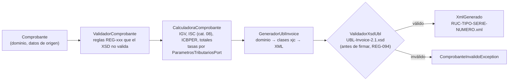

# Generador de XML UBL 2.1 (Invoice): 2.º parcial

> **Consigna:** implementar la generación de XML a partir de **UBL-Invoice-2.1.xsd**, en el lenguaje del dominio, con **pruebas unitarias de generación**.
> **Lenguaje:** Kotlin (ADR-003). **Fase 1 (especificación):** [`../specs/`](../specs/), en la que se basa este código.

## Requisitos y uso

- **JDK 21 o superior** (probado con Java 25) y **Maven 3.9**. Maven descarga Kotlin, JAXB y JUnit; no hace falta instalar nada más.

```powershell
mvn test                    # genera las clases del XSD, compila y ejecuta las 46 pruebas unitarias
mvn -q process-classes exec:java   # escribe una factura y una boleta de ejemplo en ./ejemplos-generados/
```

## Cómo funciona



| Decisión | Dónde | Por qué |
|---|---|---|
| **Clases generadas desde el XSD** (JAXB/`xjc`), sin DOM ni plantillas | `pom.xml` (`jaxb2-maven-plugin`), `ubl/GeneradorUblInvoice.kt` | ADR-007: el compilador garantiza la estructura y el *marshaller*, el orden. Las clases se generan en cada build desde `src/main/resources/xsd/ubl-2.1/` (copia del XSD oficial OASIS UBL 2.1 OS) |
| **Validación XSD antes de devolver el XML** | `ubl/ValidadorXsdUbl.kt` | REG-094: un XML inválido nunca llega a firmarse |
| **Nombres del dominio** (`Comprobante`, `LineaDetalle`, `Tributo`, `AfectacionIgv`, `SistemaIsc`…) | `dominio/` | "Lenguaje del dominio": el mismo vocabulario de `specs/02-dominio-y-contratos/modelo-dominio.md` |
| **El núcleo calcula los montos**; el cliente envía solo datos de origen | `dominio/CalculadoraComprobante.kt` | REG-059. Montos en `BigDecimal` con HALF_UP, nunca `double` |
| **Sin tasas en el código** | `dominio/ParametrosTributarios`, `aplicacion/ParametrosTributariosPort` | RNF-06. Las pruebas inyectan tasas **ilustrativas** (IGV 18.00, ICBPER 0.50), no verificadas |
| **Estructura SUNAT vigente** | `GeneradorUblInvoice` | Según las validaciones XSL de SUNAT (2022): emisor y adquirente en `PartyIdentification`/`PartyLegalEntity`, tipo de operación en `InvoiceTypeCode/@listID` (DISC-25, MT-087) |
| **Catálogos reales, no texto libre** | `dominio/Catalogos.kt` + `resources/catalogos/` | Unidad (03), moneda (02), documento (06), operación (51) y leyenda (52) se validan contra el catálogo |
| **Hexagonal** | `dominio/` no depende de nada; `aplicacion/` tiene el caso de uso y los puertos; `ubl/` tiene los adaptadores | ADR-001 y ADR-002 |

## Estructura

```
generador-ubl/
  pom.xml
  src/main/kotlin/pe/abc/fe/
    dominio/      Comprobante, LineaDetalle, catálogos, ValidadorComprobante, CalculadoraComprobante
    aplicacion/   GenerarXmlComprobanteUseCase (puerto de entrada) y puertos de salida
    ubl/          GeneradorUblInvoice (JAXB), ValidadorXsdUbl, PrefijosUbl
    demo/         GenerarEjemplos.kt (mvn -q process-classes exec:java)
  src/main/resources/
    xsd/ubl-2.1/  UBL-Invoice-2.1.xsd + common/ (OASIS UBL 2.1 OS)
    catalogos/    cat02, cat03, cat06, cat51, cat52 (copias de specs/.../catalogs)
  src/test/kotlin/pe/abc/fe/   pruebas unitarias (JUnit 5)
```

## Pruebas unitarias (46)

| Clase | Qué prueba | Trazabilidad |
|---|---|---|
| `GeneracionFacturaTest` (12) | XML válido contra el XSD 2.1; versiones; serie-número; fecha y hora; tipo 01 + `listID` del catálogo 51; moneda; emisor y adquirente en la estructura vigente; totales; una sola moneda; línea completa; prefijos | MT-002…MT-088, REG-001, REG-002, REG-057, REG-061, REG-066, REG-069, REG-094 |
| `TributosTest` (9) | IGV (afectación 10, tributo 1000); exonerado e inafecto; **ISC con los 3 sistemas del catálogo 08 en `TierRange`**; base del IGV con ISC; ICBPER (`BaseUnitMeasure` NIU + `PerUnitAmount`); sin tasa configurada no se genera | MT-061…MT-065, MT-190…MT-192, REG-017, REG-050…REG-056, RNF-06 |
| `BoletaYFormaPagoTest` (4) | Boleta 03 con serie B y DNI; contado; crédito con cuotas `Cuota001`/`Cuota002`; cuotas que no suman el total | MT-082, MT-193…MT-196, REG-028, REG-029, REG-031 |
| `ValidacionesTest` (16) | Serie, correlativo, RUC, DNI, factura sin RUC, catálogos 02, 03, 06, 51 y 52, sin líneas, cantidad 0, vencimiento, código SUNAT, varias violaciones juntas | REG-006, REG-011…REG-044, REG-067, REG-081 |
| `ValidadorXsdTest` (5) | El validador acepta el XML bueno y **rechaza** un elemento inventado, el orden incorrecto, un obligatorio faltante y el XML mal formado | REG-094 |

## Fuera del alcance de este parcial

- **Firma digital** (`ext:UBLExtensions/ds:Signature`, REG-090): la agrega `FirmadorXmlPort` después de esta validación. Se genera `cac:Signature` con la referencia.
- **Notas de crédito y débito**, resumen diario y baja: la consigna pide Invoice (factura y boleta).
- **Operaciones gratuitas, descuentos y anticipos** (REG-055, catálogo 53): no implementados.
- **Tasas oficiales**: las pruebas usan valores ilustrativos. Fórmulas del ISC y base del IGV con ISC: SUPUESTO (REG-052, REG-053).
