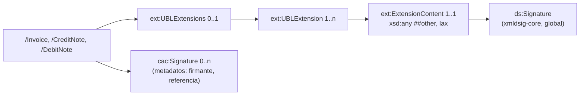

# Mapa del XSD UBL para SUNAT

> **Fuente principal:** `Git/UBL-2.1/xsd/` (OASIS **UBL 2.1 OS**, 04/11/2013; 79 XSD en `maindoc/` y `common/`). **Control cruzado:** `Git/tradeshift-ubl-xsd/.../schemas/` (UBL 2.2, 96 XSD).
> ✅ **Versión: UBL 2.1**, la que exige el Anexo 9-A. Las 127 rutas de la matriz existen en 2.1 y en 2.2 con la misma cardinalidad, y el primer nivel de `InvoiceType` es idéntico en ambas (comprobación M11). SUP-01 y DISC-03 quedan cerrados.
> **Cómo se generó:** las tablas de la sección 5 salen de `tools/generar_mapa_xsd.py`, que usa `tools/ubl_xsd.py`. La resolución de rutas es la misma que aplica `tools/verificar_matriz.py`.

## 1. Documentos raíz e imports

| Documento SUNAT | Raíz UBL | XSD (2.1) | Espacio de nombres | Anexo 9-A |
|---|---|---|---|---|
| Factura (01) | `Invoice` | `maindoc/UBL-Invoice-2.1.xsd` | `urn:oasis:names:specification:ubl:schema:xsd:Invoice-2` | lit. a), págs. 1–10 |
| Boleta (03) | `Invoice` | ídem | ídem | lit. b), págs. 11–18 |
| Nota de crédito (07) | `CreditNote` | `maindoc/UBL-CreditNote-2.1.xsd` | `…:CreditNote-2` | lit. c), págs. 19–22 |
| Nota de débito (08) | `DebitNote` | `maindoc/UBL-DebitNote-2.1.xsd` | `…:DebitNote-2` | lit. d), págs. 23–27 |
| Resumen diario | `SummaryDocuments` | ❌ **No disponible** (esquema SUNAT, prefijo `sac:`). Rutas confirmadas por la validación SUNAT (XSL Summary-1.1.0) | — | lit. E), págs. 28–30 |
| Comunicación de baja | `VoidedDocuments` | ❌ **No disponible** (esquema SUNAT, prefijo `sac:`). Rutas confirmadas por la validación SUNAT (XSL SummaryVoided-1.0.1) | — | lit. F), pág. 31 |

Cadena de imports: `maindoc/*.xsd` → `common/UBL-CommonAggregateComponents` (cac), `CommonBasicComponents` (cbc) y `CommonExtensionComponents` (ext). Luego `ext` → `ExtensionContentDataType` → `UBL-xmldsig-core-schema` (ds), `XAdES 1.3.2/1.4.1`. Por último, `cbc` → `UnqualifiedDataTypes` (udt) → `CCTS_CCT_SchemaModule`.

Prefijos usados en todo el entregable:

| Prefijo | Espacio de nombres |
|---|---|
| `cac` | `urn:oasis:names:specification:ubl:schema:xsd:CommonAggregateComponents-2` |
| `cbc` | `urn:oasis:names:specification:ubl:schema:xsd:CommonBasicComponents-2` |
| `ext` | `urn:oasis:names:specification:ubl:schema:xsd:CommonExtensionComponents-2` |
| `ds` | `http://www.w3.org/2000/09/xmldsig#` |
| `sac` | Extensión SUNAT: **sin XSD en el workspace** (PENDIENTE) |

## 2. Lugar de la firma digital

- El Anexo 9-A (págs. 1, 11, 19 y 23) ubica la **firma digital** en `/{raíz}/ext:UBLExtensions/ext:UBLExtension/ext:ExtensionContent/ds:Signature`, y la **información adicional de la firma** en `/{raíz}/cac:Signature` (0..n, pág. 3).
- `ext:ExtensionContent` admite **cualquier elemento** de otro espacio de nombres (`xsd:any processContents="lax"`). Por eso el XSD **no obliga** a que exista `ds:Signature` ni valida la firma criptográficamente. Solo valida su estructura si el elemento está presente y su esquema está importado (lo está: `UBL-xmldsig-core-schema-2.1.xsd`).
- Para el resumen diario y la baja, el anexo usa la misma ruta de firma (págs. 28 y 31), pero no hay XSD para verificarla.

## 3. Lo que el XSD NO valida (alimenta `reglas-de-validacion.md`)

El XSD solo garantiza **estructura**: qué elemento va dentro de cuál, su orden, su cardinalidad y su tipo léxico (fecha, decimal, texto). Todo lo siguiente queda fuera y se especifica como regla de negocio:

| # | Qué no valida el XSD | Ejemplo | Regla(s) |
|---|---|---|---|
| X-01 | **Valores de catálogo**: los códigos son `udt:CodeType` o `IdentifierType`, es decir, cualquier texto | `InvoiceTypeCode="99"` es válido para el XSD | REG-010 a REG-024 |
| X-02 | **Cardinalidad SUNAT más estricta** que la de UBL | `cbc:ID` de la línea es 1 en ambos, pero `InvoiceTypeCode` es 0..1 en UBL y la factura lo necesita | REG-001 a REG-009 |
| X-03 | **Formato de serie y correlativo** (`F###-NNNNNNNN`) | `cbc:ID="ABC"` es válido para el XSD | REG-030 a REG-033 |
| X-04 | **Unicidad y continuidad del correlativo** por emisor, tipo y serie | Dos facturas con `F001-00000001` | REG-034 y REG-035 |
| X-05 | **RUC**: longitud, solo dígitos y dígito verificador | `CompanyID="123"` | REG-040 y REG-041 |
| X-06 | **Coherencia de `@schemeID`** con el número de documento (6 = RUC de 11 dígitos, 1 = DNI) | `schemeID="6"` con 8 dígitos | REG-042 y REG-043 |
| X-07 | **Cálculo de impuestos**: IGV = base × tasa, ISC según el sistema del catálogo 08, ICBPER | `TaxAmount` arbitrario | REG-050 a REG-058 |
| X-08 | **Coherencia de totales**: suma de líneas, descuentos, cargos, anticipos y total a pagar | `PayableAmount` ≠ suma | REG-060 a REG-066 |
| X-09 | **Redondeo y número de decimales** (`n(12,2)`, `n(12,10)`) | 15 decimales en un monto | REG-067 y REG-068 |
| X-10 | **Una sola moneda** por documento (`@currencyID` = `DocumentCurrencyCode`) | Montos en USD dentro de una factura en PEN | REG-069 |
| X-11 | **Combinaciones de catálogos**: afectación (07) ↔ tributo (05); tipo de operación (51) ↔ tipo de documento (01) | Afectación 20 (exonerado) con tributo 1000 | REG-022 y REG-023 |
| X-12 | **Documento afectado** de una nota: que exista, que sea del mismo emisor y que su serie empiece con la misma letra | NC `F001` que modifica una boleta `B001` | REG-070 a REG-074 |
| X-13 | **Fechas**: la emisión no es futura y el vencimiento es posterior o igual a la emisión | `DueDate` < `IssueDate` | REG-080 y REG-081 |
| X-14 | **Firma**: que exista, que sea criptográficamente válida y que el certificado sea vigente y del emisor | XML sin `ds:Signature` | REG-090 y REG-091 |
| X-15 | **Valores fijos SUNAT** (`UBLVersionID`, `CustomizationID`, `@listAgencyName="PE:SUNAT"`) | `UBLVersionID="9.9"` | REG-001 y REG-002 |
| X-16 | **Longitudes máximas SUNAT** (`an..100`, `an..250`) | Razón social de 500 caracteres | REG-100 |
| X-17 | **Plazos** de envío, baja y resumen | Baja fuera de plazo | REG-110 y REG-111 (PENDIENTE de norma) |
| X-18 | **Resumen diario y baja**: no hay XSD | — | REG-120 a REG-124 |

## 4. Erratas de XPath en el Anexo 9-A detectadas al verificarlas contra el XSD

| ID | Pág. | XPath en el anexo | Problema según el XSD 2.1 (igual en 2.2) | XPath usado en la matriz |
|---|---|---|---|---|
| DISC-07 | 22 | `/CreditNote/cac:CreditLine/cac:Item/...` | `cac:CreditLine` no es hijo de `CreditNoteType` | `/CreditNote/cac:CreditNoteLine/cac:Item/...` |
| DISC-08 | 23 | `/DebitNote/cac:BillingReference/cac:DebitDocumentReference` | No existe; `BillingReferenceType` tiene `cac:DebitNoteDocumentReference` | Ver la nota ↓ |
| DISC-10 | 4, 5 | `.../cac:CarrierParty/cac:cac:PartyLegalEntity` y `cacPartyLegalEntity` | Prefijo duplicado o sin `:` (errata tipográfica) | Fuera del alcance (transporte) |
| DISC-11 | 19 | `/CreditNote/cac:BillingReference/cac:CreditNoteDocumentReference` | Existe en el XSD, pero semánticamente el documento afectado es una factura o boleta (`cac:InvoiceDocumentReference`) | **Cerrada**: la validación SUNAT usa `cac:InvoiceDocumentReference`. La matriz se corrigió (MT-099, MT-100) |

Nota sobre DISC-08 y DISC-11: la validación SUNAT vigente (`ValidaExprRegNC-2.0.1`, `ValidaExprRegND-2.0.1`) usa `cac:BillingReference/cac:InvoiceDocumentReference` en ambas notas. Las dos discrepancias quedan **cerradas**.

## 5. Estructura relevante (generada)

Solo se listan los hijos que usa el Anexo 9-A. Columna "Card. XSD": la cardinalidad que impone UBL. La cardinalidad SUNAT (más estricta) está en la matriz de trazabilidad.

<!-- Generado por tools/generar_mapa_xsd.py desde 79 XSD -->

#### Raíz `Invoice`

| Elemento | Card. XSD | Tipo base | Atributos admitidos |
|---|---|---|---|
| ext:UBLExtensions | 0..1 | UBLExtensionsType |  |
| cbc:UBLVersionID | 0..1 | udt:IdentifierType | schemeAgencyID, schemeAgencyName, schemeDataURI, schemeID, schemeName, schemeURI, schemeVersionID |
| cbc:CustomizationID | 0..1 | udt:IdentifierType | schemeAgencyID, schemeAgencyName, schemeDataURI, schemeID, schemeName, schemeURI, schemeVersionID |
| cbc:ProfileID | 0..1 | udt:IdentifierType | schemeAgencyID, schemeAgencyName, schemeDataURI, schemeID, schemeName, schemeURI, schemeVersionID |
| cbc:ID | 1..1 | udt:IdentifierType | schemeAgencyID, schemeAgencyName, schemeDataURI, schemeID, schemeName, schemeURI, schemeVersionID |
| cbc:IssueDate | 1..1 | udt:DateType |  |
| cbc:IssueTime | 0..1 | udt:TimeType |  |
| cbc:DueDate | 0..1 | udt:DateType |  |
| cbc:InvoiceTypeCode | 0..1 | udt:CodeType | languageID, listAgencyID, listAgencyName, listID, listName, listSchemeURI, listURI, listVersionID, name |
| cbc:Note | 0..n | udt:TextType | languageID, languageLocaleID |
| cbc:DocumentCurrencyCode | 0..1 | udt:CodeType | languageID, listAgencyID, listAgencyName, listID, listName, listSchemeURI, listURI, listVersionID, name |
| cbc:LineCountNumeric | 0..1 | udt:NumericType | format |
| cac:InvoicePeriod | 0..n | PeriodType |  |
| cac:OrderReference | 0..1 | OrderReferenceType |  |
| cac:BillingReference | 0..n | BillingReferenceType |  |
| cac:DespatchDocumentReference | 0..n | DocumentReferenceType |  |
| cac:AdditionalDocumentReference | 0..n | DocumentReferenceType |  |
| cac:Signature | 0..n | SignatureType |  |
| cac:AccountingSupplierParty | 1..1 | SupplierPartyType |  |
| cac:AccountingCustomerParty | 1..1 | CustomerPartyType |  |
| cac:Delivery | 0..n | DeliveryType |  |
| cac:PaymentMeans | 0..n | PaymentMeansType |  |
| cac:PaymentTerms | 0..n | PaymentTermsType |  |
| cac:PrepaidPayment | 0..n | PaymentType |  |
| cac:AllowanceCharge | 0..n | AllowanceChargeType |  |
| cac:TaxTotal | 0..n | TaxTotalType |  |
| cac:LegalMonetaryTotal | 1..1 | MonetaryTotalType |  |
| cac:InvoiceLine | 1..n | InvoiceLineType |  |

#### Raíz `CreditNote`

| Elemento | Card. XSD | Tipo base | Atributos admitidos |
|---|---|---|---|
| ext:UBLExtensions | 0..1 | UBLExtensionsType |  |
| cbc:UBLVersionID | 0..1 | udt:IdentifierType | schemeAgencyID, schemeAgencyName, schemeDataURI, schemeID, schemeName, schemeURI, schemeVersionID |
| cbc:CustomizationID | 0..1 | udt:IdentifierType | schemeAgencyID, schemeAgencyName, schemeDataURI, schemeID, schemeName, schemeURI, schemeVersionID |
| cbc:ProfileID | 0..1 | udt:IdentifierType | schemeAgencyID, schemeAgencyName, schemeDataURI, schemeID, schemeName, schemeURI, schemeVersionID |
| cbc:ID | 1..1 | udt:IdentifierType | schemeAgencyID, schemeAgencyName, schemeDataURI, schemeID, schemeName, schemeURI, schemeVersionID |
| cbc:IssueDate | 1..1 | udt:DateType |  |
| cbc:IssueTime | 0..1 | udt:TimeType |  |
| cbc:Note | 0..n | udt:TextType | languageID, languageLocaleID |
| cbc:DocumentCurrencyCode | 0..1 | udt:CodeType | languageID, listAgencyID, listAgencyName, listID, listName, listSchemeURI, listURI, listVersionID, name |
| cbc:LineCountNumeric | 0..1 | udt:NumericType | format |
| cac:InvoicePeriod | 0..n | PeriodType |  |
| cac:DiscrepancyResponse | 0..n | ResponseType |  |
| cac:OrderReference | 0..1 | OrderReferenceType |  |
| cac:BillingReference | 0..n | BillingReferenceType |  |
| cac:DespatchDocumentReference | 0..n | DocumentReferenceType |  |
| cac:AdditionalDocumentReference | 0..n | DocumentReferenceType |  |
| cac:Signature | 0..n | SignatureType |  |
| cac:AccountingSupplierParty | 1..1 | SupplierPartyType |  |
| cac:AccountingCustomerParty | 1..1 | CustomerPartyType |  |
| cac:Delivery | 0..n | DeliveryType |  |
| cac:PaymentMeans | 0..n | PaymentMeansType |  |
| cac:PaymentTerms | 0..n | PaymentTermsType |  |
| cac:AllowanceCharge | 0..n | AllowanceChargeType |  |
| cac:TaxTotal | 0..n | TaxTotalType |  |
| cac:LegalMonetaryTotal | 1..1 | MonetaryTotalType |  |
| cac:CreditNoteLine | 1..n | CreditNoteLineType |  |

#### Raíz `DebitNote`

| Elemento | Card. XSD | Tipo base | Atributos admitidos |
|---|---|---|---|
| ext:UBLExtensions | 0..1 | UBLExtensionsType |  |
| cbc:UBLVersionID | 0..1 | udt:IdentifierType | schemeAgencyID, schemeAgencyName, schemeDataURI, schemeID, schemeName, schemeURI, schemeVersionID |
| cbc:CustomizationID | 0..1 | udt:IdentifierType | schemeAgencyID, schemeAgencyName, schemeDataURI, schemeID, schemeName, schemeURI, schemeVersionID |
| cbc:ProfileID | 0..1 | udt:IdentifierType | schemeAgencyID, schemeAgencyName, schemeDataURI, schemeID, schemeName, schemeURI, schemeVersionID |
| cbc:ID | 1..1 | udt:IdentifierType | schemeAgencyID, schemeAgencyName, schemeDataURI, schemeID, schemeName, schemeURI, schemeVersionID |
| cbc:IssueDate | 1..1 | udt:DateType |  |
| cbc:IssueTime | 0..1 | udt:TimeType |  |
| cbc:Note | 0..n | udt:TextType | languageID, languageLocaleID |
| cbc:DocumentCurrencyCode | 0..1 | udt:CodeType | languageID, listAgencyID, listAgencyName, listID, listName, listSchemeURI, listURI, listVersionID, name |
| cbc:LineCountNumeric | 0..1 | udt:NumericType | format |
| cac:InvoicePeriod | 0..n | PeriodType |  |
| cac:DiscrepancyResponse | 0..n | ResponseType |  |
| cac:OrderReference | 0..1 | OrderReferenceType |  |
| cac:BillingReference | 0..n | BillingReferenceType |  |
| cac:DespatchDocumentReference | 0..n | DocumentReferenceType |  |
| cac:AdditionalDocumentReference | 0..n | DocumentReferenceType |  |
| cac:Signature | 0..n | SignatureType |  |
| cac:AccountingSupplierParty | 1..1 | SupplierPartyType |  |
| cac:AccountingCustomerParty | 1..1 | CustomerPartyType |  |
| cac:PrepaidPayment | 0..n | PaymentType |  |
| cac:AllowanceCharge | 0..n | AllowanceChargeType |  |
| cac:Delivery | 0..n | DeliveryType |  |
| cac:PaymentMeans | 0..n | PaymentMeansType |  |
| cac:PaymentTerms | 0..n | PaymentTermsType |  |
| cac:TaxTotal | 0..n | TaxTotalType |  |
| cac:RequestedMonetaryTotal | 1..1 | MonetaryTotalType |  |
| cac:DebitNoteLine | 1..n | DebitNoteLineType |  |

#### UBLExtensions (firma) (`ext:UBLExtensionsType`)

| Elemento | Card. XSD | Tipo base | Atributos admitidos |
|---|---|---|---|
| ext:UBLExtension | 1..n | UBLExtensionType |  |

#### UBLExtension (`ext:UBLExtensionType`)

| Elemento | Card. XSD | Tipo base | Atributos admitidos |
|---|---|---|---|
| ext:ExtensionContent | 1..1 | ExtensionContentType |  |

#### ExtensionContent (`ext:ExtensionContentType`)

| Elemento | Card. XSD | Tipo base | Atributos admitidos |
|---|---|---|---|
| `xsd:any` (##other, lax) | 1..1 |  |  |

#### Party (`cac:PartyType`)

| Elemento | Card. XSD | Tipo base | Atributos admitidos |
|---|---|---|---|
| cac:PartyIdentification | 0..n | PartyIdentificationType |  |
| cac:PartyName | 0..n | PartyNameType |  |
| cac:PostalAddress | 0..1 | AddressType |  |
| cac:PartyTaxScheme | 0..n | PartyTaxSchemeType |  |
| cac:PartyLegalEntity | 0..n | PartyLegalEntityType |  |

#### PartyTaxScheme (`cac:PartyTaxSchemeType`)

| Elemento | Card. XSD | Tipo base | Atributos admitidos |
|---|---|---|---|
| cbc:RegistrationName | 0..1 | udt:NameType | languageID, languageLocaleID |
| cbc:CompanyID | 0..1 | udt:IdentifierType | schemeAgencyID, schemeAgencyName, schemeDataURI, schemeID, schemeName, schemeURI, schemeVersionID |
| cac:RegistrationAddress | 0..1 | AddressType |  |
| cac:TaxScheme | 1..1 | TaxSchemeType |  |

#### Address (`cac:AddressType`)

| Elemento | Card. XSD | Tipo base | Atributos admitidos |
|---|---|---|---|
| cbc:ID | 0..1 | udt:IdentifierType | schemeAgencyID, schemeAgencyName, schemeDataURI, schemeID, schemeName, schemeURI, schemeVersionID |
| cbc:AddressTypeCode | 0..1 | udt:CodeType | languageID, listAgencyID, listAgencyName, listID, listName, listSchemeURI, listURI, listVersionID, name |
| cbc:StreetName | 0..1 | udt:NameType | languageID, languageLocaleID |
| cbc:CitySubdivisionName | 0..1 | udt:NameType | languageID, languageLocaleID |
| cbc:CityName | 0..1 | udt:NameType | languageID, languageLocaleID |
| cbc:CountrySubentity | 0..1 | udt:TextType | languageID, languageLocaleID |
| cbc:CountrySubentityCode | 0..1 | udt:CodeType | languageID, listAgencyID, listAgencyName, listID, listName, listSchemeURI, listURI, listVersionID, name |
| cbc:District | 0..1 | udt:TextType | languageID, languageLocaleID |
| cac:AddressLine | 0..n | AddressLineType |  |
| cac:Country | 0..1 | CountryType |  |

#### BillingReference (`cac:BillingReferenceType`)

| Elemento | Card. XSD | Tipo base | Atributos admitidos |
|---|---|---|---|
| cac:InvoiceDocumentReference | 0..1 | DocumentReferenceType |  |
| cac:SelfBilledInvoiceDocumentReference | 0..1 | DocumentReferenceType |  |
| cac:CreditNoteDocumentReference | 0..1 | DocumentReferenceType |  |
| cac:SelfBilledCreditNoteDocumentReference | 0..1 | DocumentReferenceType |  |
| cac:DebitNoteDocumentReference | 0..1 | DocumentReferenceType |  |
| cac:ReminderDocumentReference | 0..1 | DocumentReferenceType |  |
| cac:AdditionalDocumentReference | 0..1 | DocumentReferenceType |  |
| cac:BillingReferenceLine | 0..n | BillingReferenceLineType |  |

#### Response (DiscrepancyResponse) (`cac:ResponseType`)

| Elemento | Card. XSD | Tipo base | Atributos admitidos |
|---|---|---|---|
| cbc:ReferenceID | 0..1 | udt:IdentifierType | schemeAgencyID, schemeAgencyName, schemeDataURI, schemeID, schemeName, schemeURI, schemeVersionID |
| cbc:ResponseCode | 0..1 | udt:CodeType | languageID, listAgencyID, listAgencyName, listID, listName, listSchemeURI, listURI, listVersionID, name |
| cbc:Description | 0..n | udt:TextType | languageID, languageLocaleID |

#### PaymentTerms (`cac:PaymentTermsType`)

| Elemento | Card. XSD | Tipo base | Atributos admitidos |
|---|---|---|---|
| cbc:ID | 0..1 | udt:IdentifierType | schemeAgencyID, schemeAgencyName, schemeDataURI, schemeID, schemeName, schemeURI, schemeVersionID |
| cbc:PaymentMeansID | 0..n | udt:IdentifierType | schemeAgencyID, schemeAgencyName, schemeDataURI, schemeID, schemeName, schemeURI, schemeVersionID |
| cbc:PaymentPercent | 0..1 | udt:PercentType | format |
| cbc:Amount | 0..1 | udt:AmountType | currencyCodeListVersionID, currencyID |
| cbc:PaymentDueDate | 0..1 | udt:DateType |  |

#### AllowanceCharge (`cac:AllowanceChargeType`)

| Elemento | Card. XSD | Tipo base | Atributos admitidos |
|---|---|---|---|
| cbc:ChargeIndicator | 1..1 | udt:IndicatorType |  |
| cbc:AllowanceChargeReasonCode | 0..1 | udt:CodeType | languageID, listAgencyID, listAgencyName, listID, listName, listSchemeURI, listURI, listVersionID, name |
| cbc:MultiplierFactorNumeric | 0..1 | udt:NumericType | format |
| cbc:Amount | 1..1 | udt:AmountType | currencyCodeListVersionID, currencyID |
| cbc:BaseAmount | 0..1 | udt:AmountType | currencyCodeListVersionID, currencyID |

#### TaxTotal (`cac:TaxTotalType`)

| Elemento | Card. XSD | Tipo base | Atributos admitidos |
|---|---|---|---|
| cbc:TaxAmount | 1..1 | udt:AmountType | currencyCodeListVersionID, currencyID |
| cbc:RoundingAmount | 0..1 | udt:AmountType | currencyCodeListVersionID, currencyID |
| cbc:TaxEvidenceIndicator | 0..1 | udt:IndicatorType |  |
| cbc:TaxIncludedIndicator | 0..1 | udt:IndicatorType |  |
| cac:TaxSubtotal | 0..n | TaxSubtotalType |  |

#### TaxSubtotal (`cac:TaxSubtotalType`)

| Elemento | Card. XSD | Tipo base | Atributos admitidos |
|---|---|---|---|
| cbc:TaxableAmount | 0..1 | udt:AmountType | currencyCodeListVersionID, currencyID |
| cbc:TaxAmount | 1..1 | udt:AmountType | currencyCodeListVersionID, currencyID |
| cbc:Percent | 0..1 | udt:PercentType | format |
| cbc:BaseUnitMeasure | 0..1 | udt:MeasureType | unitCode, unitCodeListVersionID |
| cbc:PerUnitAmount | 0..1 | udt:AmountType | currencyCodeListVersionID, currencyID |
| cac:TaxCategory | 1..1 | TaxCategoryType |  |

#### TaxCategory (`cac:TaxCategoryType`)

| Elemento | Card. XSD | Tipo base | Atributos admitidos |
|---|---|---|---|
| cbc:ID | 0..1 | udt:IdentifierType | schemeAgencyID, schemeAgencyName, schemeDataURI, schemeID, schemeName, schemeURI, schemeVersionID |
| cbc:Percent | 0..1 | udt:PercentType | format |
| cbc:TaxExemptionReasonCode | 0..1 | udt:CodeType | languageID, listAgencyID, listAgencyName, listID, listName, listSchemeURI, listURI, listVersionID, name |
| cbc:TierRange | 0..1 | udt:TextType | languageID, languageLocaleID |
| cbc:TierRatePercent | 0..1 | udt:PercentType | format |
| cac:TaxScheme | 1..1 | TaxSchemeType |  |

#### TaxScheme (`cac:TaxSchemeType`)

| Elemento | Card. XSD | Tipo base | Atributos admitidos |
|---|---|---|---|
| cbc:ID | 0..1 | udt:IdentifierType | schemeAgencyID, schemeAgencyName, schemeDataURI, schemeID, schemeName, schemeURI, schemeVersionID |
| cbc:Name | 0..1 | udt:NameType | languageID, languageLocaleID |
| cbc:TaxTypeCode | 0..1 | udt:CodeType | languageID, listAgencyID, listAgencyName, listID, listName, listSchemeURI, listURI, listVersionID, name |

#### MonetaryTotal (`cac:MonetaryTotalType`)

| Elemento | Card. XSD | Tipo base | Atributos admitidos |
|---|---|---|---|
| cbc:LineExtensionAmount | 0..1 | udt:AmountType | currencyCodeListVersionID, currencyID |
| cbc:TaxExclusiveAmount | 0..1 | udt:AmountType | currencyCodeListVersionID, currencyID |
| cbc:TaxInclusiveAmount | 0..1 | udt:AmountType | currencyCodeListVersionID, currencyID |
| cbc:AllowanceTotalAmount | 0..1 | udt:AmountType | currencyCodeListVersionID, currencyID |
| cbc:ChargeTotalAmount | 0..1 | udt:AmountType | currencyCodeListVersionID, currencyID |
| cbc:PrepaidAmount | 0..1 | udt:AmountType | currencyCodeListVersionID, currencyID |
| cbc:PayableRoundingAmount | 0..1 | udt:AmountType | currencyCodeListVersionID, currencyID |
| cbc:PayableAmount | 1..1 | udt:AmountType | currencyCodeListVersionID, currencyID |
| cbc:PayableAlternativeAmount | 0..1 | udt:AmountType | currencyCodeListVersionID, currencyID |

#### InvoiceLine (`cac:InvoiceLineType`)

| Elemento | Card. XSD | Tipo base | Atributos admitidos |
|---|---|---|---|
| cbc:ID | 1..1 | udt:IdentifierType | schemeAgencyID, schemeAgencyName, schemeDataURI, schemeID, schemeName, schemeURI, schemeVersionID |
| cbc:InvoicedQuantity | 0..1 | udt:QuantityType | unitCode, unitCodeListAgencyID, unitCodeListAgencyName, unitCodeListID |
| cbc:LineExtensionAmount | 1..1 | udt:AmountType | currencyCodeListVersionID, currencyID |
| cac:PricingReference | 0..1 | PricingReferenceType |  |
| cac:Delivery | 0..n | DeliveryType |  |
| cac:AllowanceCharge | 0..n | AllowanceChargeType |  |
| cac:TaxTotal | 0..n | TaxTotalType |  |
| cac:Item | 1..1 | ItemType |  |
| cac:Price | 0..1 | PriceType |  |

#### CreditNoteLine (`cac:CreditNoteLineType`)

| Elemento | Card. XSD | Tipo base | Atributos admitidos |
|---|---|---|---|
| cbc:ID | 1..1 | udt:IdentifierType | schemeAgencyID, schemeAgencyName, schemeDataURI, schemeID, schemeName, schemeURI, schemeVersionID |
| cbc:CreditedQuantity | 0..1 | udt:QuantityType | unitCode, unitCodeListAgencyID, unitCodeListAgencyName, unitCodeListID |
| cbc:LineExtensionAmount | 0..1 | udt:AmountType | currencyCodeListVersionID, currencyID |
| cac:PricingReference | 0..1 | PricingReferenceType |  |
| cac:TaxTotal | 0..n | TaxTotalType |  |
| cac:Item | 0..1 | ItemType |  |
| cac:Price | 0..1 | PriceType |  |

#### DebitNoteLine (`cac:DebitNoteLineType`)

| Elemento | Card. XSD | Tipo base | Atributos admitidos |
|---|---|---|---|
| cbc:ID | 1..1 | udt:IdentifierType | schemeAgencyID, schemeAgencyName, schemeDataURI, schemeID, schemeName, schemeURI, schemeVersionID |
| cbc:DebitedQuantity | 0..1 | udt:QuantityType | unitCode, unitCodeListAgencyID, unitCodeListAgencyName, unitCodeListID |
| cbc:LineExtensionAmount | 1..1 | udt:AmountType | currencyCodeListVersionID, currencyID |
| cac:PricingReference | 0..1 | PricingReferenceType |  |
| cac:TaxTotal | 0..n | TaxTotalType |  |
| cac:Item | 0..1 | ItemType |  |
| cac:Price | 0..1 | PriceType |  |

#### PricingReference / Price (`cac:PriceType`)

| Elemento | Card. XSD | Tipo base | Atributos admitidos |
|---|---|---|---|
| cbc:PriceAmount | 1..1 | udt:AmountType | currencyCodeListVersionID, currencyID |
| cbc:PriceTypeCode | 0..1 | udt:CodeType | languageID, listAgencyID, listAgencyName, listID, listName, listSchemeURI, listURI, listVersionID, name |

#### Item (`cac:ItemType`)

| Elemento | Card. XSD | Tipo base | Atributos admitidos |
|---|---|---|---|
| cbc:Description | 0..n | udt:TextType | languageID, languageLocaleID |
| cac:SellersItemIdentification | 0..1 | ItemIdentificationType |  |
| cac:CommodityClassification | 0..n | CommodityClassificationType |  |
| cac:AdditionalItemProperty | 0..n | ItemPropertyType |  |

#### CommodityClassification (`cac:CommodityClassificationType`)

| Elemento | Card. XSD | Tipo base | Atributos admitidos |
|---|---|---|---|
| cbc:ItemClassificationCode | 0..1 | udt:CodeType | languageID, listAgencyID, listAgencyName, listID, listName, listSchemeURI, listURI, listVersionID, name |

