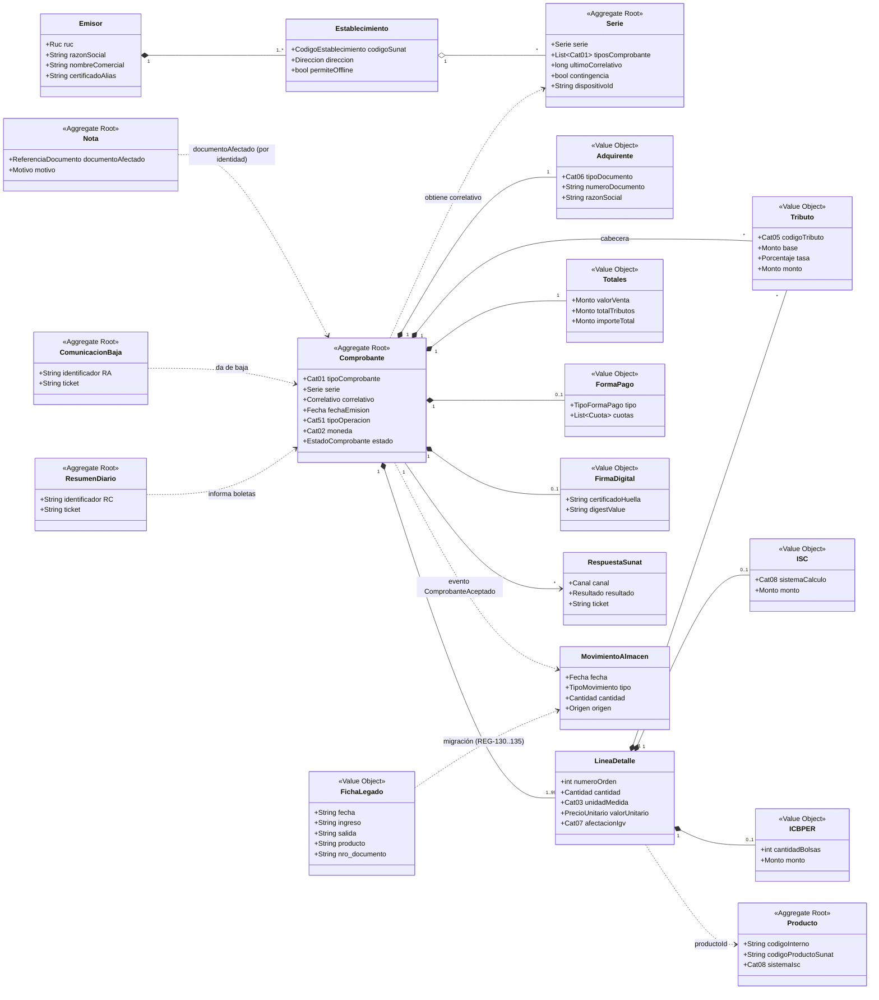
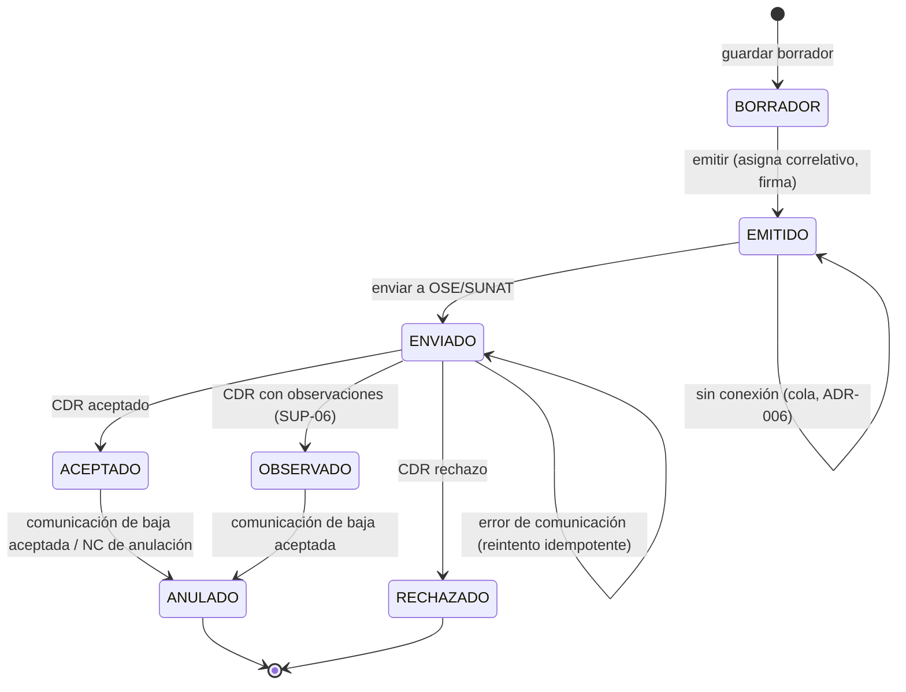

# Modelo de dominio

> **Entregable 1, parte A.** Define las entidades, los value objects y los agregados con su justificación. Los contratos están en [`schemas/`](schemas/) (JSON Schema 2020-12), las reglas en [`reglas-de-validacion.md`](reglas-de-validacion.md) y los esqueletos Kotlin en [`dtos/`](dtos/).
> **Convención de trazabilidad:** cada propiedad de un schema lleva `x-trazabilidad`, que apunta a una fila `MT-xxx` de la [matriz](../05-trazabilidad/matriz-trazabilidad.md) o vale `interno` si no proviene de SUNAT. `tools/verificar_matriz.py` comprueba ambos sentidos.

## 1. Contextos delimitados (costuras del monolito)

El monolito se organiza en **módulos que coinciden con los futuros microservicios** (ADR-001 y [mvc-hexagonal.md §6](../03-arquitectura/mvc-hexagonal.md)). Un módulo solo conoce a otro a través de su puerto de entrada o de eventos de dominio, nunca de sus tablas.

| Contexto (módulo) | Agregados que posee | Por qué es un contexto aparte |
|---|---|---|
| **Emisión** | Comprobante, Nota, Serie | Concentra las invariantes del documento (numeración, coherencia y estados). Es el núcleo. |
| **Tributación y catálogos** | ParametroTributario y catálogos (solo lectura) | Las tasas y los catálogos cambian por norma y no por venta. Tienen otro ritmo de cambio y otro responsable (contabilidad). |
| **Integración SUNAT/OSE** | Envío, RespuestaSunat, ComunicacionBaja, ResumenDiario | Su dinámica es asíncrona, con reintentos y colas, y depende de terceros. Aislarlo evita que una caída del OSE bloquee la emisión. |
| **Inventario** | Producto, MovimientoAlmacen | Continúa el legado (fichas). Lo alimentan los comprobantes por eventos. |
| **Registros** | Registro 14.1, 8.1 y 12.1 (proyecciones) | Son vistas de lectura por período, derivadas de los otros contextos (al estilo CQRS). |
| **Migración** | ImportacionLegado, FichaLegado | Es temporal (vive mientras dura la migración). Tiene reglas propias de cuarentena y no debe contaminar el núcleo. |
| **Identidad** (soporte) | Contribuyente/Emisor, Establecimiento, Adquirente | Son datos maestros compartidos. |

## 2. Entidades, value objects y agregados

| Elemento | Tipo DDD | Schema | Justificación de la decisión |
|---|---|---|---|
| **Contribuyente / Emisor** | Entidad (raíz) | `emisor.schema.yaml` | Se identifica por su RUC. Contiene los establecimientos y la referencia al certificado (solo el alias, REG-093). |
| **Establecimiento** | Entidad (dentro de Emisor) | `establecimiento.schema.yaml` | El código SUNAT (`AddressTypeCode n4`, pág. 3) es obligatorio en cada comprobante, y de él cuelgan las series (ENT-06 §6). |
| **Serie** | **Agregado propio** | `serie.schema.yaml` | El correlativo es el único punto de contención concurrente: aislarlo en su propio agregado permite bloquearlo sin bloquear el comprobante (REG-034, REG-035). Las series de contingencia por dispositivo (ADR-006) también viven aquí. |
| **Adquirente** | Value object (copiado en el comprobante) | `adquirente.schema.yaml` | El comprobante debe conservar los datos **tal como estaban al emitirlo**. Si fuera una referencia a una entidad Cliente, una edición posterior cambiaría la historia. El maestro de clientes existe aparte, pero el comprobante guarda una copia. |
| **Comprobante** (factura y boleta) | **Agregado raíz** | `comprobante.schema.yaml` | Es la unidad de consistencia: las líneas, los tributos y los totales deben cuadrar entre sí (REG-057, REG-060 a REG-066). Ningún elemento interno se modifica fuera de la raíz. |
| **Nota** (crédito y débito) | **Agregado raíz** | `nota.schema.yaml` | Tiene ciclo de vida y numeración propios. Referencia al comprobante afectado **por su identidad** (tipo + serie + correlativo), no por puntero de objeto (REG-070). |
| **LineaDetalle** | Entidad interna del agregado | `linea-detalle.schema.yaml` | Tiene identidad local (`numeroOrden`, REG-005) dentro del comprobante. |
| **Tributo** (subtotal) | Value object | `tributo.schema.yaml` | Lo define su contenido (código del catálogo 05, base, tasa y monto). Se usa en la línea y en la cabecera. |
| **ISC** | Value object de la línea | `linea-detalle#/isc` | Lo separo del Tributo genérico porque el **catálogo 08 (sistema de cálculo)** es exclusivo del ISC y es el punto clave del caso (`TierRange`, págs. 10, 17, 22 y 26). |
| **ICBPER** | Value object de la línea | `linea-detalle#/icbper` | Se calcula por **cantidad de bolsas**, no sobre la base imponible. **PENDIENTE** de norma (DISC-14). |
| **Totales** | Value object (`readOnly`) | `totales.schema.yaml` | Es un resumen derivado: **lo calcula siempre el núcleo** y el cliente no lo envía (REG-059). Lo mismo vale para el valor de venta y los tributos de cada línea. |
| **FormaPago / Cuota** | Value object | `forma-pago.schema.yaml` | Contado o crédito con cuotas (ENT-06 §3). **PENDIENTE** de norma. |
| **Leyenda** | Value object | `comprobante#/leyendas` | Código del catálogo 52 más texto. |
| **CargoDescuento** | Value object | `common#/$defs/CargoDescuento` | Catálogo 53, a nivel ítem o global (REG-024). |
| **Montos, Cantidad, Ruc, Serie, Fecha…** | Value objects | `common.schema.yaml` | Los montos son **strings decimales**, nunca `float`, para no perder precisión (REG-067). |
| **FirmaDigital** | Value object | `firma-digital.schema.yaml` | Guarda solo los metadatos de la firma aplicada: huella, digest y fecha. La clave nunca forma parte del dominio. |
| **RespuestaSunat / CDR** | Entidad (contexto Integración) | `respuesta-sunat.schema.yaml` | Tiene identidad (ticket o CDR) y fecha. Se guarda inmutable como evidencia (RNF-08). |
| **ComunicacionBaja** | Agregado raíz | `comunicacion-baja.schema.yaml` | Proceso de dos pasos con ticket (ENT-06 §8); agrupa varios documentos. |
| **ResumenDiario** | Agregado raíz | `resumen-diario.schema.yaml` | Agrupa boletas y notas de una fecha de referencia (REG-122). |
| **Producto** | Agregado raíz (Inventario) | `producto.schema.yaml` | Incluye el código de producto SUNAT (n8), la unidad (catálogo 03) y el sistema de ISC por defecto. |
| **MovimientoAlmacen** | Entidad (Inventario) | `movimiento-almacen.schema.yaml` | Es la continuación de la ficha del legado. Lleva `origen` para la trazabilidad (REG-134). |
| **FichaLegado** | Value object (entrada cruda) | `ficha-legado.schema.yaml` | Representa la fila **sin limpiar**: todos sus campos son texto. |
| **ImportacionLegado** | Agregado raíz (Migración) | `importacion-legado.schema.yaml` | Es el lote, con estado e incidencias por fila. |
| **Registro 14.1 / 8.1 / 12.1** | Read models (proyecciones) | `registro-*.schema.yaml` | Se derivan de otros agregados y no tienen invariantes propias. Su estructura oficial está **PENDIENTE** (ENT-07). |
| **ParametroTributario** | Entidad con vigencia | `parametro-tributario.schema.yaml` | Hace cumplir RNF-06: ninguna tasa vive en el código. |

## 3. Diagrama de clases (dominio)

## 4. Ciclo de vida del comprobante (RF-17)

- **Inmutabilidad:** desde `EMITIDO`, el contenido no cambia (RNF-08). Una corrección se hace con una nota o con una baja.
- **Rechazado:** el correlativo queda consumido y registrado. La regla sobre si un número rechazado puede reutilizarse está **PENDIENTE** de norma (REG-035).
- **Boleta:** pasa a `ACEPTADO` mediante el **resumen diario** (SUP-09).

## 5. Eventos de dominio (preparan la división en microservicios)

| Evento | Productor | Consumidores |
|---|---|---|
| `ComprobanteEmitido` | Emisión | Integración (enviar), Inventario (reservar) |
| `ComprobanteAceptado` / `Rechazado` | Integración | Emisión (estado), Inventario (`MovimientoAlmacen` SALIDA), Registros (14.1) |
| `ComprobanteAnulado` | Integración | Emisión, Inventario (reversión), Registros |
| `MovimientoRegistrado` | Inventario | Registros (12.1) |
| `LoteLegadoImportado` | Migración | Inventario, Registros |

## 6. Invariantes por agregado → reglas

| Agregado | Invariantes |
|---|---|
| Comprobante | REG-003 a REG-006, REG-010 a REG-025, REG-030, REG-031, REG-050 a REG-069, REG-080 a REG-082 |
| Nota | Las del comprobante, más REG-007, REG-018, REG-019, REG-032 y REG-070 a REG-074 |
| Serie | REG-033 a REG-037 y REG-170 |
| ComunicacionBaja / ResumenDiario | REG-111 y REG-120 a REG-124 |
| ImportacionLegado | REG-130 a REG-135 |
| Emisor / Firma | REG-040, REG-041 y REG-090 a REG-093 |
