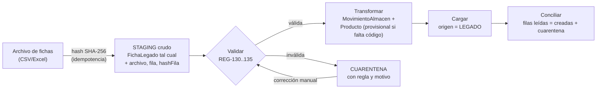

# ADR-005: Estrategia de migración del legado

- **Estado:** Aceptado (Fase 1)
- **Contexto:** Las fichas del legado tienen solo `fecha`, `ingreso`, `salida`, `producto` y `nro_documento` (documento interno informal). Se espera que vengan sucias: productos sin código, documentos repetidos, fechas inválidas e ingreso y salida a la vez (RSK-06). La restricción R-01 exige **no perder trazabilidad**.
- **Decisión:** Una migración **por etapas, idempotente y reversible**, implementada como el contexto `Migracion` (`ImportarLegadoUseCase` + `ImportadorLegadoPort`).

1. **El staging es inmutable:** la fila original se guarda **sin cambios**, con `archivo`, `fila` y `hashFila`. Es la evidencia de trazabilidad.
2. **Modo SIMULACIÓN** (por defecto) frente a **DEFINITIVO**: la simulación genera el reporte sin escribir en Inventario.
3. **No se fabrican comprobantes SUNAT** a partir del legado: `nro_documento` es un documento interno (SUP-07) y se conserva como `documentoInternoLegado`.
4. Las fichas alimentan el **12.1** (unidades físicas). No alimentan el 14.1 ni el 8.1, porque no tienen importes (SUP-08).
5. **Conciliación obligatoria:** `filasLeidas = filasMigradas + filasEnCuarentena` y `movimientosCreados = filasMigradas + filasDivididas` (REG-131). Cualquier diferencia hace fallar el lote.
6. **Reversión:** cada lote tiene un `loteImportacion`, y se pueden eliminar sus movimientos mientras no estén incluidos en un 12.1 cerrado.
- **Consecuencias:**
  - (+) Cada movimiento migrado se puede rastrear hasta su fila de origen.
  - (−) Hay que homologar a mano los productos provisionales (`requiereHomologacion`).
- **Detalle:** [mapeo-legado.md](../../06-migracion/mapeo-legado.md).
