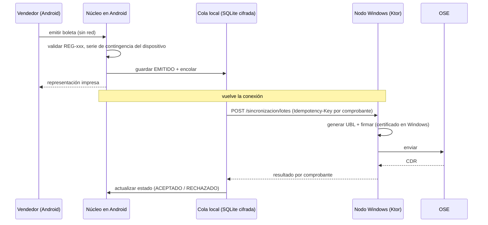

# ADR-006: Emisión sin conexión en Android

- **Estado:** Aceptado (Fase 1). Las condiciones normativas de la contingencia quedan **PENDIENTE**.
- **Requisito:** RNF-03 ([00-analisis-del-caso.md](../../00-analisis-del-caso.md)).
- **Contexto:** Los vendedores usan Android en tienda o en ruta, donde puede no haber conexión. El DEMO de Nubefact muestra una columna «Offline» por local y **series de contingencia** numéricas (ENT-06 §6), y su manual tiene el campo `generado_por_contingencia`. El certificado de facturación es un activo crítico (RSK-04) y la firma XMLDSig en Android es incierta (ADR-003).

## Decisión

| Aspecto | Decisión |
|---|---|
| **Con conexión** | Android llama al nodo Windows (`POST /comprobantes`, adaptador HTTP), que asigna la serie electrónica, firma y envía. |
| **Sin conexión** | Android ejecuta `EmitirComprobanteUseCase` **en el mismo proceso** (el núcleo es el mismo) con una **serie de contingencia asignada a ese dispositivo** (`Serie.contingencia = true`, `dispositivoId`). El comprobante queda en estado `EMITIDO` (`origen = DISPOSITIVO_OFFLINE`), se imprime la representación y se encola. |
| **Cola de envío** | `ColaEnvioPort` sobre SQLite: una entrada por comprobante, con `Idempotency-Key = emisor+tipo+serie+correlativo`, intentos y próximo intento (*backoff* exponencial). Se sincroniza con `POST /sincronizacion/lotes` en cuanto hay red. |
| **Almacenamiento local** | SQLite **cifrada**. La clave de cifrado vive en el **Android Keystore** (no es exportable). Los datos se borran de forma segura tras la confirmación y el período de retención (a definir). |
| **Custodia del certificado** | El certificado de facturación **no** se instala en Android. La firma la aplica el nodo Windows (o el OSE o proveedor, ADR-004) al recibir el lote. Así, la pérdida de un dispositivo no compromete el certificado. |
| **Numeración** | Bloques de correlativos de contingencia **reservados por dispositivo** desde el nodo central (`POST /series/contingencia/asignaciones`). Esto evita colisiones (RSK-05) porque dos dispositivos nunca comparten serie (REG-034). |
| **Plazos** | El plazo máximo para informar los comprobantes de contingencia es un parámetro (`PLAZO_ENVIO_DIAS`) **PENDIENTE de norma** (REG-110). El dispositivo avisa al acercarse el límite. |
| **Conflictos** | Si el nodo rechaza un comprobante del lote (por ejemplo, por un RUC inválido), no se borra: queda `RECHAZADO` con su `Problema` y requiere una acción manual (por ejemplo, una NC). |

## Consecuencias

- (+) La venta no se detiene sin red, el certificado está protegido y la numeración no colisiona.
- (−) Hay una ventana entre la emisión y la firma, que queda condicionada a la norma de contingencia (**PENDIENTE**).
- (−) Hay que asignar series por dispositivo y administrar su ciclo de vida (alta, baja y robo).
