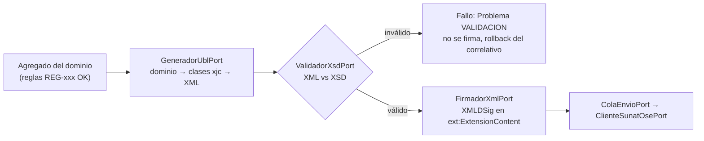

# ADR-007: Generación del XML UBL con clases derivadas del XSD, y validación antes de firmar

- **Estado:** Aceptado (Fase 1)
- **Contexto:** `GeneradorUblPort` convierte los agregados del dominio (Comprobante, Nota, ResumenDiario, ComunicacionBaja) en XML UBL. Hay tres formas habituales de hacerlo:

| Opción | Descripción | Problema |
|---|---|---|
| A. Árbol DOM a mano | Se crean los nodos uno por uno (`createElement`, `appendChild`) a partir del DTO | El orden y la cardinalidad dependen del programador: un nodo fuera de orden solo se detecta al validar (si se valida). Hay mucho código frágil y duplicado entre Invoice, CreditNote y DebitNote |
| B. Plantillas de texto | XML con marcadores que se rellenan | Mismos riesgos que A; además hay que escapar caracteres a mano |
| **C. Clases generadas desde el XSD** (JAXB / `xjc`) | Se generan clases Java/Kotlin desde los XSD UBL (`maindoc/` + `common/`). El adaptador mapea dominio → clases y serializa (*marshal*) | Genera más clases, pero el **compilador** garantiza la estructura, el orden lo garantiza el *marshaller* y el XSD queda como única fuente de verdad estructural |

## Decisión

1. **Opción C.** Las clases se generan en el build (tarea Gradle con `xjc`) desde los XSD UBL. La fuente es el XSD oficial **OASIS UBL 2.1 OS** (`Git/UBL-2.1/xsd`), la versión que exige el Anexo 9-A. Las clases viven **solo** en `adapters-ubl` (infraestructura): el dominio **no** las conoce (ADR-002).
2. El adaptador hace un **mapeo explícito dominio → clases UBL**. Ese mapeo sigue el XPath de cada fila de la [matriz](../../05-trazabilidad/matriz-trazabilidad.md) (columna `xpath_ubl`). Un nodo que el anexo pide y la matriz no tiene es un error de especificación, no de código.
3. **Extensiones SUNAT sin XSD** (`SummaryDocuments`, `VoidedDocuments`, prefijo `sac:`): no hay XSD en el workspace (ENT-08). Mientras tanto, esas clases se escriben a mano, con anotaciones JAXB y siguiendo las págs. 28–31 del Anexo 9-A. Quedan marcadas **PENDIENTE** de regenerarse cuando se obtenga el XSD de SUNAT.
4. **Orden del pipeline de emisión (REG-094):**

   La validación XSD va **antes** de la firma. Si fuera después, se firmaría un XML inválido: la firma se desperdicia y, en el peor caso, se envía al OSE un documento ya numerado y firmado que será rechazado.
5. `ValidadorXsdPort` carga los XSD una sola vez (caché del `Schema` compilado) y valida en memoria. En Android no se valida (no se genera UBL allí, ADR-006). La validación ocurre en el nodo Windows.

## Consecuencias

- (+) Errores de estructura y orden imposibles por construcción. El XSD cumple dos papeles: fuente de las clases y red de seguridad.
- (+) Si SUNAT exige otra versión, basta con regenerar las clases y volver a correr `tools/verificar_matriz.py` (M11 compara versiones).
- (−) Las clases UBL son muchas y pesadas, pero solo viven en el adaptador. Hay que configurar `xjc` con *bindings* para los espacios de nombres `cac`, `cbc`, `ext` y `ds`.
- (−) Para las extensiones `sac:` se escriben clases a mano mientras falte el XSD (riesgo RSK-09).
