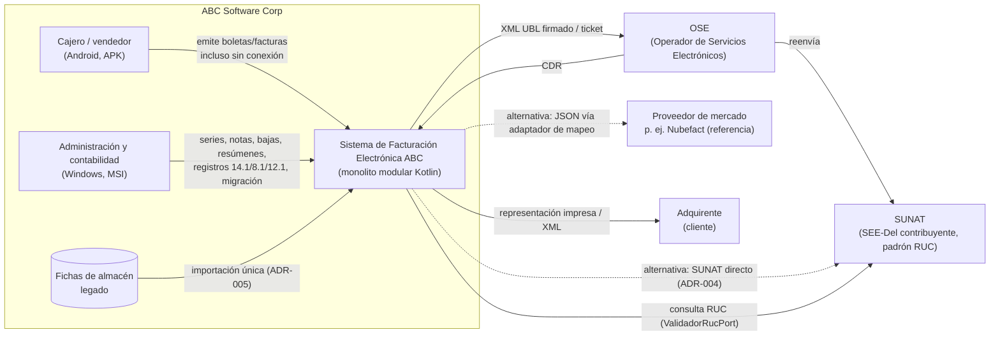
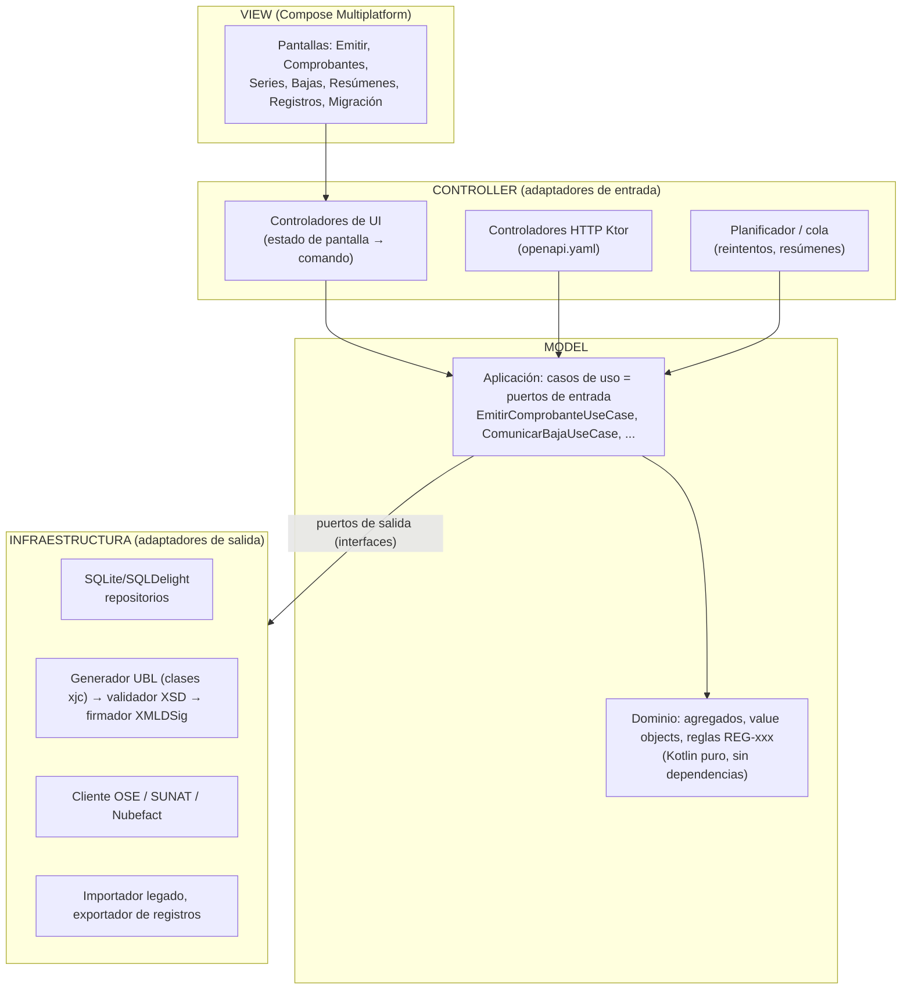
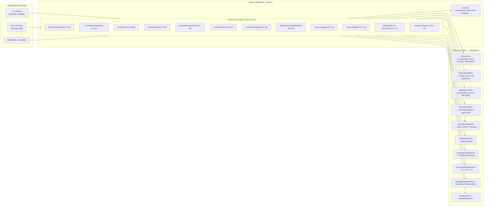
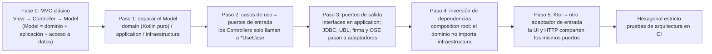
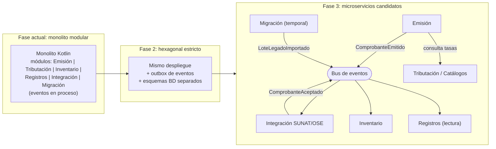
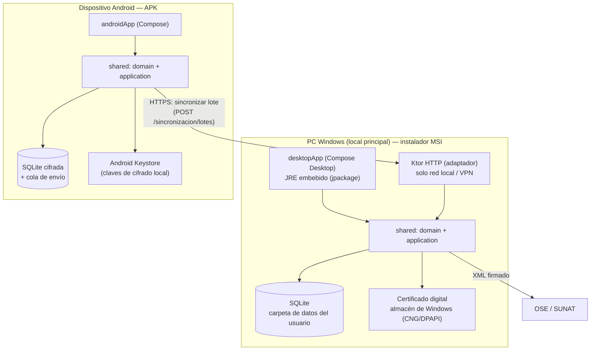

# Arquitectura: MVC con visión hexagonal

> **Entregable 2.** Contexto, capas MVC, hexágono, evolución a microservicios y despliegue en Windows (MSI) y Android (APK).
> **Decisiones:** [ADR-001](adr/ADR-001-monolito-mvc-modular.md) (monolito MVC modular), [ADR-002](adr/ADR-002-puertos-y-adaptadores.md) (puertos y adaptadores), [ADR-003](adr/ADR-003-stack-y-empaquetado.md) (Kotlin + Compose Multiplatform, MSI/APK), [ADR-004](adr/ADR-004-ose-vs-sunat-y-firma.md) (OSE y firma), [ADR-005](adr/ADR-005-estrategia-migracion.md) (migración), [ADR-006](adr/ADR-006-operacion-sin-conexion-android.md) (sin conexión en Android), [ADR-007](adr/ADR-007-generacion-ubl-con-clases-del-xsd.md) (UBL con clases del XSD; validar antes de firmar).
> **Idea central:** en una app nativa, **el contrato real es el puerto de entrada** (un caso de uso invocado en el mismo proceso por la UI). HTTP es **solo un adaptador más**: lo usan los dispositivos Android para sincronizar con el nodo Windows y, en el futuro, los microservicios.

## 1. Diagrama de contexto



## 2. Capas MVC (vista del monolito)

El MVC se aplica **en el borde**, y el *Model* se descompone en dominio y aplicación para que no dependa del framework.



**Regla de dependencias:** `View → Controller → Application → Domain`. La infraestructura implementa interfaces declaradas en *Application*. El dominio no importa nada de Compose, Ktor, SQL ni XML. Esto permite **cambiar MVC por Clean/Hexagonal sin tocar el dominio** (ADR-001).

## 3. Hexágono: puertos y adaptadores



El detalle de cada puerto, con sus firmas Kotlin y su operación HTTP, está en [`../04-api/puertos.md`](../04-api/puertos.md).

## 4. Estructura de módulos (costuras ya marcadas)

```
abc-fe/                                   (Gradle multi-módulo, Kotlin)
  shared/
    domain/{emision,tributacion,inventario,registros,migracion,integracion}   ← Kotlin común, sin dependencias
    application/{emision,...}             ← puertos de entrada (casos de uso) y de salida (interfaces)
    adapters-persistence/                 ← SQLDelight (SQLite) — un esquema POR contexto
    adapters-ubl/                         ← GeneradorUbl + Firmador (JVM desktop)
    adapters-sunat/{ose,sunat-directo,nubefact}
  desktopApp/  (Compose Desktop + Ktor server)  → MSI
  androidApp/  (Compose Android)                → APK
```

**Costuras:** (1) un paquete por contexto en `domain` y `application`. (2) Un esquema de base de datos por contexto, sin *joins* entre contextos. (3) Comunicación entre contextos solo por puertos de entrada o eventos (`EventosDominioPort`, [modelo-dominio.md §5](../02-dominio-y-contratos/modelo-dominio.md)). (4) Ningún DTO de un contexto en la firma de otro, salvo los de `comun`.

## 5. Ruta de transición MVC → Hexagonal

El sistema **nace como MVC** (fase 0) y llega a **hexagonal** en pasos pequeños y verificables, sin reescribir el dominio. Cada paso tiene un criterio de salida comprobable, y el siguiente no empieza hasta cumplirlo.



| Paso | Qué cambia | Qué NO cambia | Criterio de salida (verificable) |
|---|---|---|---|
| **0. MVC** (punto de partida) | Pantallas Compose (View), controladores de pantalla (Controller) y *Model* con entidades, reglas y repositorios juntos. Es lo que se entrega primero, porque es simple para el equipo | — | La emisión de una factura funciona de punta a punta |
| **1. Separar el Model** | El *Model* se divide en `domain` (agregados, value objects, reglas REG-xxx), `application` (orquestación) e `infra` (SQL, XML) | Pantallas y controladores | `domain` compila sin dependencias de Compose, Ktor, SQL ni JAXB |
| **2. Puertos de entrada** | Cada acción de un controlador pasa a ser un `*UseCase` (tabla de [puertos.md §1](../04-api/puertos.md)). El controlador solo traduce pantalla ↔ comando | Las reglas del dominio | Ningún controlador accede a un repositorio directamente |
| **3. Puertos de salida** | Se declaran interfaces (`SerieRepositoryPort`, `GeneradorUblPort`, `ValidadorXsdPort`, `FirmadorXmlPort`, `ClienteSunatOsePort`, …) en `application`. Las implementaciones pasan a `adapters-*` | Los casos de uso, que solo dependen de interfaces | Los casos de uso se prueban con adaptadores falsos, sin base de datos ni red |
| **4. Inversión de dependencias** | Un *composition root* por plataforma (desktopApp y androidApp) conecta cada puerto con su adaptador. En Android, `ClienteSunatOsePort` va hacia el nodo Windows (ADR-006) | Dominio y casos de uso | Cambiar el adaptador OSE por el de SUNAT directo es un cambio de configuración (ADR-004) |
| **5. HTTP como adaptador** | Se agrega Ktor ([openapi.yaml](../04-api/openapi.yaml)) **sobre los mismos puertos** que usa la UI | Los puertos | Cada `operationId` declara su `x-puerto-entrada` (lo verifica `validar_contratos.py`, V3) |
| **6. Hexagonal estricto** | Las reglas de dependencia se vuelven pruebas automáticas (Konsist o ArchUnit) en CI, junto con el *outbox* de eventos | — | Construir el proyecto falla si `domain` importa infraestructura o si un módulo lee las tablas de otro (ADR-001) |

**Equivalencia MVC ↔ Hexagonal:** View + Controller = adaptadores de entrada. *Model* = `application` (puertos de entrada) + `domain`. El acceso a datos, UBL, la firma y el OSE, que en MVC vivían "dentro del Model", quedan como **adaptadores de salida** detrás de puertos.

## 6. Ruta de evolución hacia microservicios (después del hexagonal)



| Microservicio candidato | Se extrae primero porque… | Puerto que se convierte en API remota |
|---|---|---|
| **Integración SUNAT/OSE** | Es el más volátil (proveedor, latencia, reintentos) y escala distinto. | `ClienteSunatOsePort` → servicio de envíos |
| **Tributación/Catálogos** | Es de solo lectura, cambia por norma y lo comparte todo el sistema. | `CatalogoRepositoryPort`, `ParametrosTributariosPort` |
| **Registros** | Es CQRS puro (proyecciones por período). | `GenerarRegistroUseCase` |
| **Migración** | Es temporal y se puede apagar al terminar. | `ImportarLegadoUseCase` |
| **Inventario** | Se acopla a Emisión solo por eventos. | `MovimientoRepositoryPort` |
| **Emisión** | Es el núcleo: se extrae al final. | `EmitirComprobanteUseCase` |

## 7. Despliegue: Windows (MSI) y Android (APK)



**Especificación de empaquetado** (no se construyen instaladores en la Fase 1):

| Plataforma | Artefacto | Herramienta | Contenido | Requisitos del entorno de construcción |
|---|---|---|---|---|
| Windows 10/11 x64 | `.msi` | Plugin Compose Multiplatform `nativeDistributions` (`TargetFormat.Msi`), que usa `jpackage` | App + JRE recortado + SQLite. `upgradeUuid` fijo para que las actualizaciones reemplacen la versión anterior. Firma de código Authenticode (certificado de código, **distinto** del certificado de facturación) | JDK 17 o superior y **WiX Toolset** (lo exige `jpackage` para generar MSI) |
| Android 8.0 o superior (minSdk a definir) | `.apk` (y `.aab` para tienda) | Android Gradle Plugin | App + SQLite cifrada | Android SDK. El APK se firma con el *keystore* de publicación |

Los **requisitos no funcionales** de despliegue están en [00-analisis-del-caso.md](../00-analisis-del-caso.md) (RNF-02 y RNF-03).
